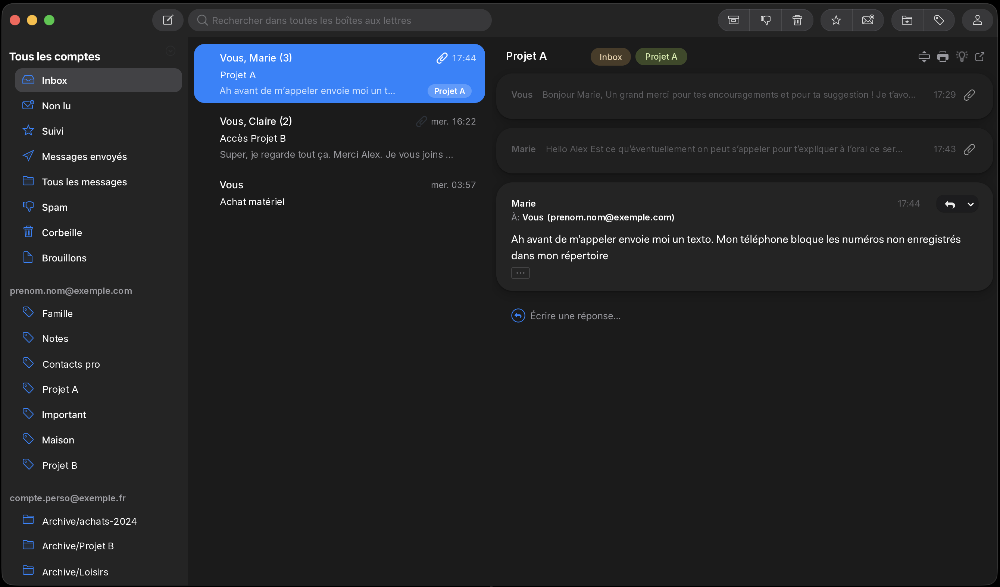

# iOS Glass Dark

Thème sombre pour [Mailspring](https://getmailspring.com), inspiré d'iOS 26 (Liquid Glass).



## Caractéristiques

- Palette sombre à plat : barre latérale, liste et lecture sur des gris distincts, sans trait superflu entre les panneaux.
- Accent bleu iOS (`#0A84FF`) pour la sélection, les icônes et les actions.
- Conversations en pastilles arrondies, avec un fondu doux à la sélection et au survol.
- Cartes de message arrondies, zone « Écrire une réponse » sans fond ni ombre.
- Fenêtre de rédaction épurée : pas de contour bleu dans l'éditeur, bouton Envoyer en capsule.
- Corps des emails lisible en mode d'affichage sombre : pas de bloc noir derrière le texte.
- Uniquement du Less : pas de JavaScript, pas de build.

## Installation

Mailspring lit les thèmes dans son dossier `packages`. Le dossier du thème doit s'appeler `ui-ios-glass-dark`.

1. Fermer Mailspring.
2. Cloner le dépôt dans le dossier `packages` :

   ```sh
   cd ~/Library/Application\ Support/Mailspring/packages
   git clone https://github.com/hugues1277/mailspring-ios-26-theme.git ui-ios-glass-dark
   ```

   Sans git : télécharger l'archive du dépôt, la décompresser et renommer le dossier en `ui-ios-glass-dark`.

3. Relancer Mailspring.
4. Ouvrir **Mailspring > Préférences > Thèmes** (`Cmd + ,`) et choisir **iOS Glass Dark**.

Emplacement du dossier `packages` selon le système :

| Système | Dossier |
|---|---|
| macOS | `~/Library/Application Support/Mailspring/packages` |
| Linux | `~/.config/Mailspring/packages` |
| Windows | `%APPDATA%\Mailspring\packages` |

Seul macOS a été testé.

## Mise à jour

```sh
cd ~/Library/Application\ Support/Mailspring/packages/ui-ios-glass-dark
git pull
```

Recharger ensuite Mailspring : menu **Developer > Reload**, ou quitter (`Cmd + Q`) et relancer.

## Structure

| Fichier | Rôle |
|---|---|
| `package.json` | Métadonnées du thème |
| `styles/ui-variables.less` | Palette (`@ios-*`) et variables Mailspring |
| `styles/ios-glass.less` | Règles de l'interface |
| `styles/email-frame.less` | Règles injectées dans l'iframe des emails |

Ne pas créer de `styles/index.less` : Mailspring ne chargerait alors plus que ce fichier et ignorerait `email-frame.less`.

## Personnalisation

Les couleurs sont définies en tête de [`styles/ui-variables.less`](styles/ui-variables.less). Modifier les variables `@ios-*` (par exemple `@ios-accent`) puis recharger Mailspring.

En cas d'erreur de compilation Less, Mailspring affiche « Error compiling Less stylesheet ». Cliquer sur « Continuer » et non sur « Reset Theme and Restart », qui réinitialise les thèmes.

## Licence

MIT, voir [LICENSE](LICENSE).
